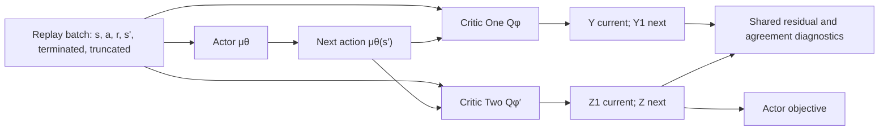

# Three Network DDPG

**Status:** The standard four-network DDPG baseline is verified by focused CPU tests. The proposed target-free three-network method now has an experimental executable core with controlled agreement, beta, simultaneous, sequential, and guarded ablations. TD3, SAC, A2C, and A3C remain unimplemented. The [original research specification](docs/research/source/Three_Network_DDPG_Research_Specification.docx) is preserved verbatim.

DDPG uses a deterministic actor and a value critic, usually with slowly updated target copies of both networks. Target networks reduce movement in the bootstrap target but do not establish general convergence for nonlinear actor–critic learning. They also add parameter storage. This project asks whether one actor and two independently optimized critics can maintain a useful Bellman relation without target networks in the proposed main variant.

The proposal gives Critic One the current side of a shared temporal difference residual and Critic Two the bootstrap side and actor objective. Matching the critics on current and next inputs may prevent incompatible value estimates, yet the actor update can increase the residual and either agreement penalty can rotate a critic update away from residual descent. We will test gradient flow, local or minibatch descent diagnostics, and reproducible control performance before attempting a theory claim.

## Hypothesis and limits

**Research hypothesis:** A target-free, three-network deterministic actor–critic method may maintain useful critic agreement and improve empirical stability or cost relative to verified DDPG under an appropriate update schedule and regularizer. This is a question to test, not an established result.

**Non-claims:** We do not claim global convergence, convergence to an optimal policy, monotonic return improvement, lower compute cost, or novelty. A descent result on one acceptance minibatch does not imply descent on the replay distribution or better return. The beta regularizer and any convergence statement are **provisional**.

## Architecture and notation

For a batch of transitions `(s, a, r, s', terminated, truncated)`, `μθ` is the deterministic actor. `Qφ` is Critic One and `Qφ′` is Critic Two; each critic has its own optimizer. Let `a' = μθ(s')`. `Y = Qφ(s,a)` and `Z1 = Qφ′(s,a)` use identical current inputs. `Y1 = Qφ(s',a')` and `Z = Qφ′(s',a')` use identical next inputs.

With an explicitly chosen bootstrap mask `m`, the shared residual is `δ = r + γ m Z − Y` and its diagnostic error is `e = ½ mean(δ²)`. Current agreement error is `½ mean((Z1 − Y)²)`; next agreement error is `½ mean((Y1 − Z)²)`. `m` must handle termination and truncation deliberately; see [notation](docs/research/notation.md). The board derivation omitted terminal masking, so implementation must add it. The actor maximizes Critic Two on next states in the initial interpretation, with current states reserved as an ablation.

**Warning:** The original linear beta term can drive negative `Y` values downward and does not bound their magnitude. Linear and quadratic variants are research alternatives. The unavailable l2_y_z mode is rejected because symmetric Z regularization needs an advisor-approved, separately named objective. The final objective and convergence statement remain unresolved; see [open questions](docs/research/open_questions.md).

### Executable controlled variant

The proposed implementation uses one actor and two independently initialized critics with no target modules. The shared-error-only setting remains the reference. Agreement modes none, current, next, and both; beta modes none, experimental linear_y, and l2_y; and schedules sequential, simultaneous, and guarded are executable. A guard can cover the joint update, critics, or actor, and can monitor a separate replay batch. Next-state actor input remains the reconstructed default. See [three-network controlled implementation](docs/research/three_network_core.md) for formulas, detach rules, and limits.

## Roadmap

1. Maintain and empirically validate the implemented standard DDPG baseline on Pendulum and later tasks.
2. Maintain and empirically validate the implemented shared-error reference and its verified gradient paths.
3. Evaluate the implemented no, current, next, and both critic-agreement modes.
4. Evaluate the implemented beta and schedule ablations; actor state source, initialization, and actor delay remain separate research axes.
5. Run fair multi-seed studies and failure analysis.
6. Refine a local descent theory for the selected implementation and its actual assumptions.
7. Review novelty against target-free, residual-gradient, and twin-critic literature before framing a contribution.

## Set up and commands that work now

Use Python 3.11 and CPU by default. The environment file installs the editable package with development tools. The environment smoke command exercises a seeded random policy. The DDPG and three-network commands perform short local learning runs and record artifacts; their default budgets are for execution checks, not scientific comparison.

~~~bash
conda env create -f environment.yml
conda activate three-network-ddpg
python -m pip install -e ".[dev]"
three-network-ddpg --help
three-network-ddpg algorithms
three-network-ddpg config validate
three-network-ddpg config show
three-network-ddpg env-smoke --environment tiny_continuous --steps 6 --seed 2
three-network-ddpg env-smoke --environment pendulum_v1 --steps 3 --seed 2
three-network-ddpg train-ddpg --environment pendulum_v1 --experiment ddpg_baseline
three-network-ddpg train-three-network --environment pendulum_v1 --experiment three_network_core
three-network-ddpg train-three-network --environment tiny_continuous --experiment three_network_core \
  --set experiment.total_steps=24 --set experiment.warmup_steps=4 \
  --set experiment.batch_size=4 --set algorithm.hidden_layers=[16,16] \
  --set algorithm.agreement_mode=both --set algorithm.alpha=0.1 \
  --set algorithm.alpha_prime=0.1 --set algorithm.beta_regularizer.mode=l2_y \
  --set algorithm.beta_regularizer.coefficient=0.0001 \
  --set algorithm.update_schedule=guarded --set algorithm.guard.scope=joint \
  --set algorithm.guard.validation_batch=true
python -m pytest
ruff check .
ruff format --check .
~~~

For local TensorBoard or plotting support, install `.[tracking]` or `.[plotting]`. Weights & Biases remains optional under `.[wandb]`. No account or network service is required for default local tracking.

**Available:** `DDPG`, experimental `ThreeNetworkDDPG`, `ReplayBuffer`, `OffPolicyTrainer`, `evaluate`, `make_environment`, action transforms, seed helpers, and `prepare_run_directory`. Both training commands write resolved configuration, metadata, JSONL metrics, a summary, and a checkpoint. TD3, SAC, A2C, and A3C remain `planned` and cannot enter the trainer. Plotting and general checkpoint-management commands are planned.

## Layout and extension points

| Path | Purpose |
| --- | --- |
| `src/three_network_ddpg/core/` | Typed batches, action transforms, replay, interfaces, seeds, metadata |
| `src/three_network_ddpg/environments.py` | Tiny deterministic fixture and Pendulum-v1 factory |
| `src/three_network_ddpg/training.py`, `evaluation.py` | Off-policy trainer shell and separate noise-free evaluator |
| `src/three_network_ddpg/algorithms/` | Metadata registry and implemented DDPG and three-network modules plus explicit TD3, SAC, A2C, and A3C placeholders |
| `src/three_network_ddpg/conf/` | Composable algorithm, environment, experiment YAML |
| `docs/research/` | Problem, notation, architecture, protocol, reproducibility, baseline policy, questions, decisions |
| `tests/` | Fast scaffold checks; later gradient and integration tests |
| `data/`, `runs/`, `reports/` | Local inputs and generated outputs, ignored except guidance files |
| `notebooks/`, `prompts/` | Exploration and reusable research prompts |

To add an algorithm, document its capability metadata and experimental role, add a config group, then implement `OffPolicyAlgorithm` or `OnPolicyAlgorithm`. Only the former enters `OffPolicyTrainer`; A3C needs its own multiprocessing design. Register a factory after behavior, gradient, and serialization tests pass. To add an environment, add a YAML group, extend the factory, and add a seeded smoke test. The factory currently rejects nonempty wrapper lists. Keep training, evaluation, wrappers, tracking, and plotting separate.

## Configurations and outputs

The packaged YAML groups compose with OmegaConf and validate cross-field constraints. The proposed method supports explicit agreement and beta modes, sequential, simultaneous, and guarded schedules, current or next actor input, guard scope and backtracking settings, optional validation-batch monitoring, and interval-controlled gradient diagnostics. It still rejects target networks, identical critic initialization, and delayed actor updates. DDPG and TD3 reserve their own target-network settings. Device is cpu unless explicitly changed. The user-facing auto option resolves once to cpu or cuda at runtime; run metadata records both the requested and resolved values. DDPG collection supports gaussian or none exploration modes, and evaluation is always noise-free.

Each training command creates `runs/<experiment>/<algorithm>/<environment>/<timestamp>-seed-<seed>/` and writes the resolved config, requested and resolved device, seed, Git commit, package versions, UTC start time, CPU/GPU and OS metadata, JSONL metrics, summary, and checkpoint. The summary marks a single smoke run as non-evidentiary. Future study tooling must add final status and multi-seed aggregation. Keep aggregates and figures under `reports/`, linked to raw run IDs.

## Reproducibility and comparison policy

Seed Python, NumPy, PyTorch, action spaces, and environments where supported. Record the actual seeds and deterministic backend settings; exact determinism is not guaranteed across devices or operations. Call the evaluator with a separate seeded environment; it requests deterministic actions and rejects actions flagged as exploratory. Record wrapper order, Gymnasium version and environment ID, Git commit hash, resolved configuration, package versions, hardware, timestamps, and failure or rejection counts. Retain every seed's raw results; aggregate only after all planned seeds, and report uncertainty and divergence rather than choosing successful runs.

DDPG and TD3 are the primary direct continuous-control comparisons. A2C and A3C are later on-policy contextual baselines, architecturally different from DDPG; A3C needs a separate multiprocessing design. SAC is a useful continuous-control reference but changes policy stochasticity and entropy assumptions. No external baseline code is vendored. Later paths are a clean tested implementation under the common interface or a thin adapter to a maintained library; copied or adapted code requires provenance and license review. See [baseline policy](docs/research/baselines.md).

## Team workflow

Branch from `main` for each feature, open a pull request, request review, and use conventional commits. Keep changes focused and run fast tests and lint before review. Never commit generated datasets, runs, checkpoints, environments, caches, or secrets. Document configuration and evidence for research choices; update the changelog. Do not push or rewrite Git history without explicit authorization.

## Open research questions

The source asks whether removing the target actor preserves stability and return; whether independent critics can replace the online/target critic relationship; which agreement constraint is needed; when shared error is a valid local Lyapunov candidate; whether acceptance/backtracking can enforce minibatch descent without freezing improvement; whether any parameter, memory, or time benefit is measurable; and whether the principle transfers to DQN after continuous-control validation. Advisor decisions remain open on current versus next actor states, any soft-update role for Critic Two, linear versus quadratic beta or weight regularization, simultaneous versus alternating updates, the scope of a theorem, whether both agreement terms are required, and whether a guard covers the whole update or actor step. See [open questions](docs/research/open_questions.md).

## Research documents

Start with [problem](docs/research/problem.md), [notation](docs/research/notation.md), and [architecture](docs/research/architecture.md). The executable proposed-method scope is recorded in [three-network controlled implementation](docs/research/three_network_core.md). Then read the [experiment protocol](docs/research/experiments.md), [reproducibility rules](docs/research/reproducibility.md), [baseline policy](docs/research/baselines.md), the [initial decision record](docs/decisions/0001-research-scaffold.md), and the [symmetric beta decision](docs/decisions/0002-defer-symmetric-beta-objective.md).
