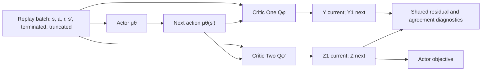

# Three Network DDPG

A PyTorch research codebase for comparing standard DDPG with experimental target-free, three-network deterministic actor–critic methods on continuous-control tasks.

**Status:** Standard DDPG is implemented with focused CPU tests; `ddpg_no_target_actor`, the three-network core, and the shared-D variants are experimental implementations. The core supports shared-error and separate-TD critic objectives, agreement and beta ablations, and controlled update schedules. A manifest-driven experiment, retry, aggregation, and plotting pipeline is available, together with documented Pendulum development results. TD3, SAC, A2C, and A3C remain unimplemented. The [original research specification](docs/research/source/Three_Network_DDPG_Research_Specification.docx) is preserved verbatim.

DDPG uses a deterministic actor and a value critic, usually with slowly updated target copies of both networks. Target networks reduce movement in the bootstrap target but do not establish general convergence for nonlinear actor–critic learning. They also add parameter storage. This project asks whether one actor and two independently optimized critics can maintain a useful Bellman relation without target networks in the proposed main variant.

The proposal gives Critic One the current side of a shared temporal difference residual and Critic Two the bootstrap side and actor objective. Matching the critics on current and next inputs may prevent incompatible value estimates, yet the actor update can increase the residual and either agreement penalty can rotate a critic update away from residual descent. We will test gradient flow, local or minibatch descent diagnostics, and reproducible control performance before attempting a theory claim.

## Hypothesis and limits

**Research hypothesis:** A target-free, three-network deterministic actor–critic method may maintain useful critic agreement and improve empirical stability or cost relative to verified DDPG under an appropriate update schedule and regularizer. This is a question to test, not an established result.

**Non-claims:** We do not claim global convergence, convergence to an optimal policy, monotonic return improvement, lower compute cost, or novelty. A descent result on one acceptance minibatch does not imply descent on the replay distribution or better return. The beta regularizer and any convergence statement are **provisional**.

## Architecture and notation

For a batch of transitions `(s, a, r, s', terminated, truncated)`, `μθ` is the deterministic actor. `Qφ` is Critic One and `Qφ′` is Critic Two; each critic has its own optimizer. Let `a' = μθ(s')`. `Y = Qφ(s,a)` and `Z1 = Qφ′(s,a)` use identical current inputs. `Y1 = Qφ(s',a')` and `Z = Qφ′(s',a')` use identical next inputs.

With an explicitly chosen bootstrap mask `m`, the shared residual is `δ = r + γ m Z − Y` and its diagnostic error is `e = ½ mean(δ²)`. Current agreement error is `½ mean((Z1 − Y)²)`; next agreement error is `½ mean((Y1 − Z)²)`. `m` must handle termination and truncation deliberately; see [notation](docs/research/notation.md). The board derivation omitted terminal masking, so implementation must add it. The actor maximizes Critic Two on next states in the initial interpretation, with current states reserved as an ablation.

**Warning:** The original linear beta term can drive negative `Y` values downward and does not bound their magnitude. Linear and quadratic variants are research alternatives. The unavailable l2_y_z mode is rejected because symmetric Z regularization needs an advisor-approved, separately named objective. The final objective and convergence statement remain unresolved; see [open questions](docs/research/open_questions.md).

### Executable controlled variant

The `three_network_ddpg` core uses one actor and two independently initialized critics with no target modules. The shared-error-only setting remains the reference. Agreement modes none, current, next, and both; beta modes none, experimental linear_y, and l2_y; and schedules sequential, simultaneous, and guarded are executable. A guard can cover the joint update, critics, or actor, and can monitor a separate replay batch. Next-state actor input remains the reconstructed default. See [three-network controlled implementation](docs/research/three_network_core.md) for formulas, detach rules, and limits.

The core also supports the opt-in `critic_objective=separate_td`: both critics regress their current-input predictions against a detached Critic Two bootstrap. This objective requires sequential updates and disabled beta regularization; `shared_error` remains the default. See the [controlled implementation](docs/research/three_network_core.md) for the distinct gradient paths.

The separately registered `three_network_shared_d*` variants retain the shared-error objective with both agreement penalties and no beta regularizer. They explore delayed actor updates, conditioning, board-aligned or paired batches, synchronous critic gradients, and two-timescale updates. Constraints differ by variant: `three_network_shared_d_board` also permits identical initial critic values with independent parameters. See the [algorithm registry](src/three_network_ddpg/algorithms/registry.py), [packaged configurations](src/three_network_ddpg/conf/algorithm/), and [conditioning diagnosis](docs/research/shared_d_instability_correction.md).

## Latest implemented research variant

The most recent implementation in this repository is `three_network_shared_d_conditioned_paired`: one actor and two independent critics, paired replay rows, asymmetric agreement penalties, and delayed actor updates after a critic-only preparation phase. It remains experimental; it is not an established replacement for DDPG. See [the current method guide](docs/research/current_method.md) for its equations, exact settings, and commands.

The short `train-three-network` command runs the original `three_network_ddpg` core. Use the conditioned-paired manifest described in the guide to run the newer variant. The historical feature branches are already contained in `main`.

## Documented development findings

The [Pendulum Pilot 01 analysis](docs/research/pendulum_pilot_01_failure_analysis.md) reports useful control from both DDPG controls, while the tested shared-error three-network settings showed growing critic values and poor returns. The [separate-TD screening](docs/research/separate_td_screening_analysis.md) reports reduced value drift in a one-training-seed screen, but performance remained below DDPG. The [shared-D long-run diagnosis](docs/research/shared_d_instability_correction.md) records further value drift and actor saturation in the inspected setting.

These are development findings for specific configurations, not a general verdict on all variants or evidence of a three-network advantage. Raw runs and checkpoints are not included in this repository; the reports record the inspected artifacts and their provenance.

## Roadmap

1. Maintain and empirically validate the implemented standard DDPG baseline on Pendulum and later tasks.
2. Compare the implemented `ddpg_no_target_actor` ablation while holding all other DDPG settings fixed; do not infer stability from smoke runs.
3. Maintain and empirically validate the implemented shared-error reference and its verified gradient paths.
4. Evaluate the implemented no, current, next, and both critic-agreement modes.
5. Evaluate the implemented beta and schedule ablations; actor state source, initialization, and actor delay remain separate research axes.
6. Run fair multi-seed studies and failure analysis.
7. Refine a local descent theory for the selected implementation and its actual assumptions.
8. Review novelty against target-free, residual-gradient, and twin-critic literature before framing a contribution.

## Canonical environment and commands

Python 3.11 is the canonical runtime for development and the first scientific runs. The portable Conda specification installs the editable package, PyTorch, Gymnasium, NumPy, pytest, and Ruff. Python 3.12 remains a CI compatibility target. Exact resolved versions belong in run metadata rather than a platform-specific environment export. CPU is the default.

Clone the repository and create the environment once:

~~~bash
git clone https://github.com/AliEtemadfard/Three_Network_DDPG.git
cd Three_Network_DDPG
conda env create --file environment.yml
conda activate three-network-ddpg
~~~

Update it after dependency changes:

~~~bash
conda env update --name three-network-ddpg --file environment.yml --prune
conda activate three-network-ddpg
~~~

From the repository root, run the checks and currently implemented commands:

~~~bash
python scripts/environment_smoke.py
ruff check .
ruff format --check .
python -m pytest
three-network-ddpg --help
three-network-ddpg algorithms
three-network-ddpg config validate
three-network-ddpg config show
three-network-ddpg env-smoke --environment tiny_continuous --steps 6 --seed 2
three-network-ddpg env-smoke --environment pendulum_v1 --steps 3 --seed 2
three-network-ddpg train-ddpg --environment pendulum_v1 --experiment ddpg_baseline
three-network-ddpg train-ddpg-no-target-actor --environment pendulum_v1 --experiment ddpg_no_target_actor
three-network-ddpg train-three-network --environment pendulum_v1 --experiment three_network_core
~~~

The environment smoke performs a CPU PyTorch operation and one seeded `Pendulum-v1` transition. Training commands use execution-check budgets and produce no scientific evidence.
For local TensorBoard or plotting support, install `.[tracking]` or `.[plotting]`. Weights & Biases remains optional under `.[wandb]`. No account or network service is required for default local tracking.

**Available:** `DDPG`, experimental `DDPGNoTargetActor`, experimental `ThreeNetworkDDPG` and the registered shared-D variants, `ReplayBuffer`, `OffPolicyTrainer`, `evaluate`, `make_environment`, action transforms, seed helpers, `prepare_run_directory`, and the manifest experiment pipeline. All three direct training commands write resolved configuration, metadata, JSONL metrics, a summary, and a checkpoint. TD3, SAC, A2C, and A3C remain `planned` and cannot enter the trainer or a manifest matrix.

## Manifest experiment workflow

`experiments/manifests/smoke.yaml` is a single-seed, 128-step infrastructure check. `development.yaml` and `confirmatory.yaml` are reviewable examples only; do not execute them until their budgets, coefficients, and preregistration are approved. `plan` is the dry-run command and never creates a study or trains. `run` executes only never-started run IDs. `resume` retries incomplete, interrupted, or failed run IDs as new attempts from the start; it does not restore the previous checkpoint or replay buffer. Prior attempts are preserved; divergent and non-finite runs remain reportable terminal outcomes.

PowerShell:

~~~powershell
$Manifest = "experiments/manifests/smoke.yaml"
three-network-ddpg experiment validate $Manifest
three-network-ddpg experiment plan $Manifest
three-network-ddpg experiment run $Manifest
three-network-ddpg experiment status $Manifest
three-network-ddpg experiment resume $Manifest
three-network-ddpg experiment aggregate $Manifest
three-network-ddpg experiment plot $Manifest --metric evaluation_return_mean
~~~

Bash:

~~~bash
manifest="experiments/manifests/smoke.yaml"
three-network-ddpg experiment validate "$manifest"
three-network-ddpg experiment plan "$manifest"
three-network-ddpg experiment run "$manifest"
three-network-ddpg experiment status "$manifest"
three-network-ddpg experiment resume "$manifest"
three-network-ddpg experiment aggregate "$manifest"
three-network-ddpg experiment plot "$manifest" --metric evaluation_return_mean
~~~

The study directory freezes the source manifest, expanded matrix, resolved configs, configuration hashes, run IDs, and Git commit. Each attempt records package and hardware metadata, UTC start/end timestamps, append-safe JSONL metrics, and an atomic terminal marker. Statuses distinguish `completed`, `interrupted`, `failed`, `divergent`, and `non_finite`; reports retain every planned run and never treat a smoke as scientific evidence.

## Layout and extension points

| Path | Purpose |
| --- | --- |
| `src/three_network_ddpg/core/` | Typed batches, action transforms, replay, interfaces, seeds, metadata |
| `src/three_network_ddpg/environments.py` | Tiny deterministic fixture and Pendulum-v1 factory |
| `src/three_network_ddpg/training.py`, `evaluation.py` | Off-policy trainer shell and separate noise-free evaluator |
| `src/three_network_ddpg/algorithms/` | Metadata registry and implemented DDPG variants and three-network modules plus explicit TD3, SAC, A2C, and A3C placeholders |
| `src/three_network_ddpg/conf/` | Composable algorithm, environment, experiment YAML |
| `docs/research/` | Problem, notation, architecture, protocol, reproducibility, baseline policy, questions, decisions |
| `tests/` | Unit and smoke coverage for gradients, update schedules, replay, configuration, training, and experiment orchestration |
| `data/`, `runs/`, `reports/` | Local inputs and generated outputs, ignored except guidance files |
| `notebooks/`, `prompts/` | Exploration and reusable research prompts |

To add an algorithm, document its capability metadata and experimental role, add a config group, then implement `OffPolicyAlgorithm` or `OnPolicyAlgorithm`. Only the former enters `OffPolicyTrainer`; A3C needs its own multiprocessing design. Register a factory after behavior, gradient, and serialization tests pass. To add an environment, add a YAML group, extend the factory, and add a seeded smoke test. The factory currently rejects nonempty wrapper lists. Keep training, evaluation, wrappers, tracking, and plotting separate.

## Configurations and outputs

The packaged YAML groups compose with OmegaConf and validate cross-field constraints. The `three_network_ddpg` core supports explicit agreement and beta modes, sequential, simultaneous, and guarded schedules, current or next actor input, guard scope and backtracking settings, optional validation-batch monitoring, and interval-controlled gradient diagnostics. The `separate_td` objective restricts this to sequential updates with beta disabled. The core rejects target networks, identical critic initialization, and delayed actor updates. Shared-D variants have separately validated initialization and update schedules; all currently reject target networks. `ddpg_no_target_actor` requires `target_networks.actor=false` and `target_networks.critic=true`; standard DDPG retains both targets, as does the planned TD3 configuration. Device is cpu unless explicitly changed. The user-facing auto option resolves once to cpu or cuda at runtime; run metadata records both the requested and resolved values. Both DDPG baselines support gaussian or none collection exploration modes, and evaluation is always noise-free.

Each direct training command creates `runs/<experiment>/<algorithm>/<environment>/<timestamp>-seed-<seed>/` and writes the resolved config, requested and resolved device, seed, Git commit, package versions, UTC start time, CPU/GPU and OS metadata, JSONL metrics, summary, and checkpoint. Manifest studies use stable variant/run IDs under `runs/protocol-v2/<study>/`, preserve immutable attempts, and write aggregates and SVG plots under the study's `reports/` directory. The summary marks a single smoke run as non-evidentiary.

## Reproducibility and comparison policy

Seed Python, NumPy, PyTorch, action spaces, and environments where supported. Record the actual seeds and deterministic backend settings; exact determinism is not guaranteed across devices or operations. Call the evaluator with a separate seeded environment; it requests deterministic actions and rejects actions flagged as exploratory. Record wrapper order, Gymnasium version and environment ID, Git commit hash, resolved configuration, package versions, hardware, timestamps, and failure or rejection counts. Retain every seed's raw results; aggregate only after all planned seeds, and report uncertainty and divergence rather than choosing successful runs.

DDPG and TD3 are the primary direct continuous-control comparisons. A2C and A3C are later on-policy contextual baselines, architecturally different from DDPG; A3C needs a separate multiprocessing design. SAC is a useful continuous-control reference but changes policy stochasticity and entropy assumptions. No external baseline code is vendored. Later paths are a clean tested implementation under the common interface or a thin adapter to a maintained library; copied or adapted code requires provenance and license review. See [baseline policy](docs/research/baselines.md).

## Team workflow

Branch from `main` for each feature, open a pull request, request review, and use conventional commits. Keep changes focused and run fast tests and lint before review. Never commit generated datasets, runs, checkpoints, environments, caches, or secrets. Document configuration and evidence for research choices; update the changelog. Do not push or rewrite Git history without explicit authorization.

## Open research questions

The source asks whether removing the target actor preserves stability and return; whether independent critics can replace the online/target critic relationship; which agreement constraint is needed; when shared error is a valid local Lyapunov candidate; whether acceptance/backtracking can enforce minibatch descent without freezing improvement; whether any parameter, memory, or time benefit is measurable; and whether the principle transfers to DQN after continuous-control validation. Advisor decisions remain open on current versus next actor states, any soft-update role for Critic Two, linear versus quadratic beta or weight regularization, simultaneous versus alternating updates, the scope of a theorem, whether both agreement terms are required, and whether a guard covers the whole update or actor step. See [open questions](docs/research/open_questions.md).

## Research documents

Start with [problem](docs/research/problem.md), [notation](docs/research/notation.md), and [architecture](docs/research/architecture.md). The executable proposed-method scope is recorded in [three-network controlled implementation](docs/research/three_network_core.md). Then read the [experiment protocol](docs/research/experiments.md), [reproducibility rules](docs/research/reproducibility.md), [baseline policy](docs/research/baselines.md), the [initial decision record](docs/decisions/0001-research-scaffold.md), and the [symmetric beta decision](docs/decisions/0002-defer-symmetric-beta-objective.md).

The [Pilot 01 guide](docs/manual_pendulum_pilot_01.md) records the stage-by-stage manual procedure; the completed pilot is discussed in the [failure analysis](docs/research/pendulum_pilot_01_failure_analysis.md).
